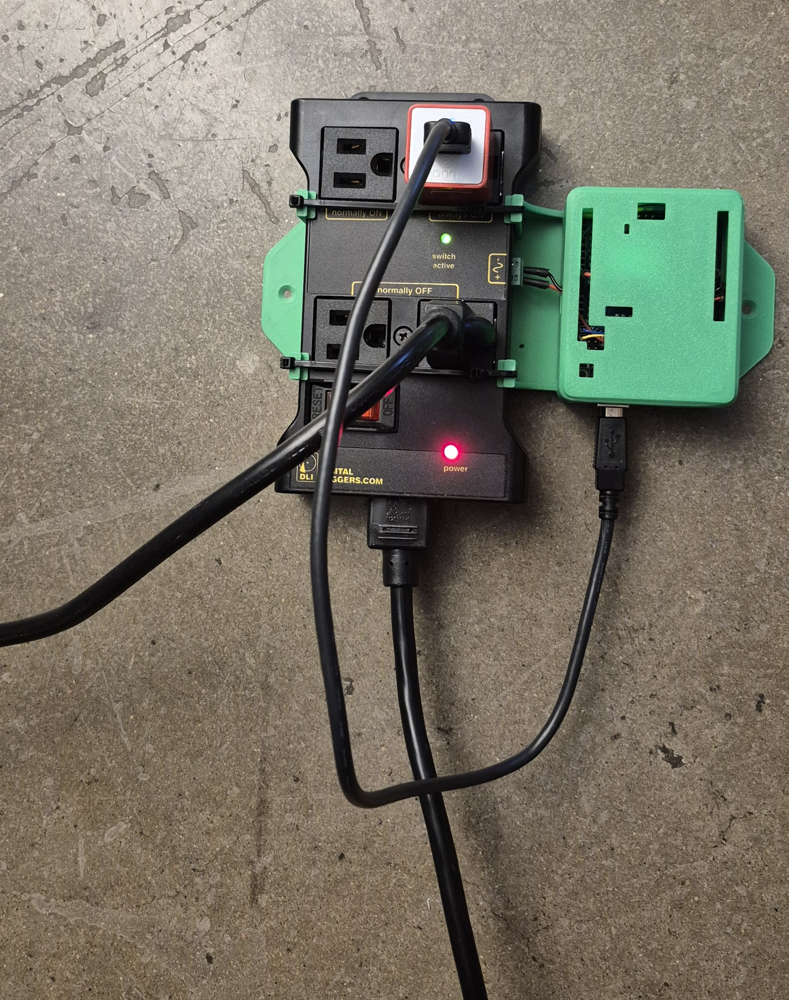
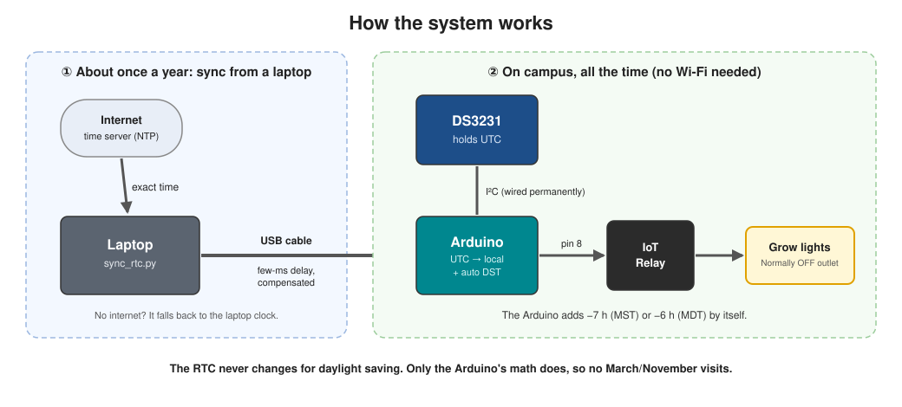
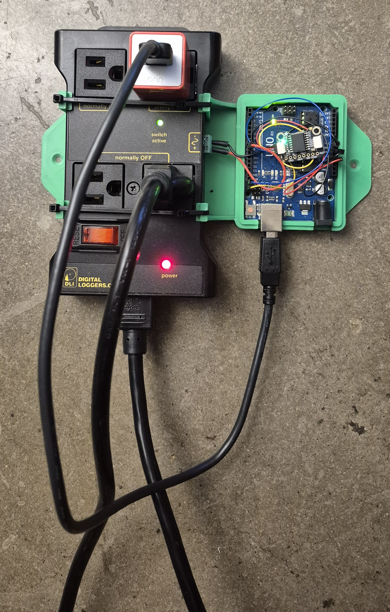

# DS3231 Relay Timer

A standalone grow-light timer. An Arduino reads a DS3231 real-time clock (RTC) and switches a Digital Loggers IoT Relay on a daily schedule. It needs no Wi-Fi or network connection. To set the clock, you connect a laptop to the Arduino over USB and run one script.

<p align="center">
  
</p>

## Features

- **Runs offline.** The schedule runs from the DS3231 clock, so the timer keeps working without Wi-Fi or internet access.
- **Handles daylight saving time automatically.** The RTC stores UTC, and the Arduino converts it to local time using the US daylight saving rules. You never need to adjust it in March or November.
- **Sets the clock to within milliseconds.** The laptop script gets the time from an internet time server (NTP), then measures and cancels out the USB delay.
- **Recovers from power cuts.** After a power cut the relay goes straight back to the scheduled state. If the clock can't be trusted, the relay is held in a configurable fail-safe state.
- **Reports clock and battery health.** Each sync reports the RTC's drift, whether it lost power, and how old the backup coin cell is.



## Hardware

| Component | Role |
|-----------|------|
| Arduino Uno R3 (or compatible) | Runs the schedule and takes clock syncs over USB |
| Adafruit DS3231 Precision RTC (STEMMA QT) with a CR1220 coin cell | Keeps accurate time, including during power cuts |
| Digital Loggers IoT Relay | Switches mains power to the grow light |
| 5 V USB power adapter and USB cable | Powers the Arduino from the relay's **Always ON** outlet |
| Grow light | Plugs into a **Normally OFF** outlet on the relay |
| 3D-printed mount (optional) | Holds the relay and the Arduino together. See [`enclosure/`](enclosure/README.md). |

The relay's **Always ON** outlet powers the Arduino through the USB adapter. The grow light plugs into a **Normally OFF** outlet, so it turns on when Arduino pin 8 goes `HIGH`. The whole system runs from a single wall socket.

<p align="center">
  
</p>

## Documentation

The full build and operation guide is in [`wiring_diagrams/`](wiring_diagrams/README.md):

1. [Arduino setup](wiring_diagrams/01_arduino_setup.md): install the libraries, set the schedule, upload the sketch
2. [Wiring](wiring_diagrams/02_wiring.md): DS3231, IoT Relay, outlets and power
3. [Clock sync](wiring_diagrams/03_sync_clock_from_laptop.md): set the RTC from a laptop
4. [Daylight saving time](wiring_diagrams/04_daylight_saving_time.md): how time zones and DST are handled
5. [Battery and maintenance](wiring_diagrams/05_battery_and_maintenance.md): coin-cell care and the yearly checklist
6. [Troubleshooting](wiring_diagrams/06_troubleshooting.md)

## Repository layout

| Path | Contents |
|------|----------|
| [`Arduino_sketches/ds3231_trigger_relay/`](Arduino_sketches/ds3231_trigger_relay) | Arduino sketch: the schedule, time-zone and DST handling, fail-safe, serial commands |
| [`laptop_sync/`](laptop_sync) | `sync_rtc.py` clock-sync script, a Windows launcher (`sync_rtc.bat`), and `requirements.txt` |
| [`wiring_diagrams/`](wiring_diagrams/README.md) | Guides, wiring diagrams, and photos of the reference build |
| [`enclosure/`](enclosure/README.md) | 3D-printable mount for the relay and the Arduino |

## Quick start

### 1. Configure and upload the sketch

Install **RTClib by Adafruit** from the Arduino Library Manager. Then edit the schedule at the top of `ds3231_trigger_relay.ino`. Times are local wall-clock time.

```cpp
Event events[] = {
  // { hour, minute, second, GPIO pin, state }
  {  0,  0,  0,  8, LOW  },   // 00:00:00 → pin 8 LOW  (lights off)
  {  8,  0,  0,  8, HIGH },   // 08:00:00 → pin 8 HIGH (lights on)
};
```

`HIGH` turns the relay on and `LOW` turns it off. Events can be listed in any order, and schedules that run past midnight work.

The default time zone is US Mountain Time:

```cpp
const int8_t STD_OFFSET_HOURS = -7;   // standard-time offset from UTC
const bool   OBSERVE_DST      = true; // apply US daylight saving rules
```

### 2. Wire it

| From | To |
|------|----|
| DS3231 VIN / GND / SDA / SCL | Arduino 5V / GND / A4 (SDA) / A5 (SCL) |
| Arduino pin 8 | IoT Relay control **+** |
| Arduino GND | IoT Relay control **−** |
| USB power adapter | IoT Relay **Always ON** outlet |
| Grow light | IoT Relay **Normally OFF** outlet |

For diagrams and photos, see the [wiring guide](wiring_diagrams/02_wiring.md).

### 3. Set the clock

Do this when you first install the timer, and about once a year after that. Close the Arduino Serial Monitor, move the Arduino's USB cable from the power adapter to a laptop, and run:

```bash
py -m pip install pyserial
```

```bash
py laptop_sync/sync_rtc.py
```

On Windows you can double-click `laptop_sync/sync_rtc.bat` instead. When the sync finishes, plug the cable back into the power adapter.

### 4. Check the status LED

| Arduino **L** LED | Meaning |
|-------------------|---------|
| Short blink every 2 s | Running normally |
| Fast blinking | The clock isn't set, or the RTC lost power. Run the sync script. |

## Acknowledgements

This codebase was refactored with the help of Claude Opus 5.5.
