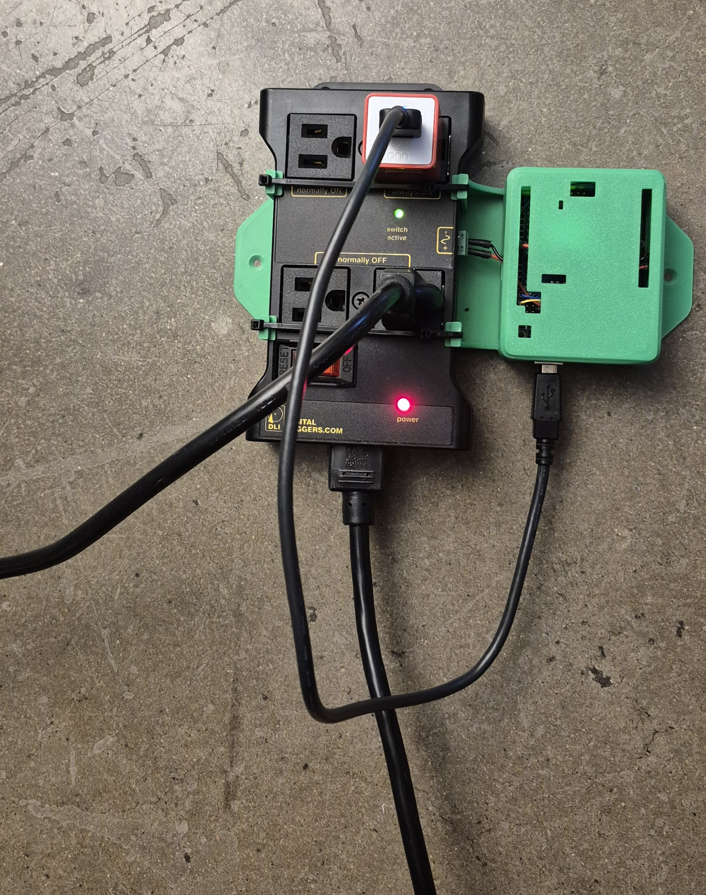
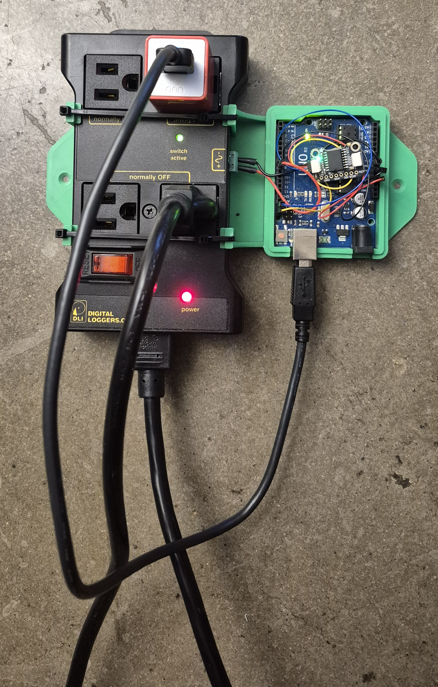

# Enclosure

This 3D-printed mount holds the Digital Loggers IoT Relay and the Arduino Uno side by side. The relay is held to the tray with two zip ties. The Arduino sits in a pocket next to the relay's control terminal, under a removable cover. Two flanges with screw holes let you mount the assembly on a wall or bench.

  
  &nbsp;
  

## Source models

The mount is a remix of two published models. The relay tray comes from the first, and the Arduino pocket and cover come from the second.

| Part | Model | Designer | License |
|------|-------|----------|---------|
| IoT Relay tray | [IoT Relay and Raspberry Pi 4B Mount](https://www.printables.com/model/818148-iot-relay-and-raspberry-pi-4b-mount) (Printables) | [Matt Hawley](https://www.printables.com/@MattHawley_1311153) | [CC BY-NC 4.0](https://creativecommons.org/licenses/by-nc/4.0/) |
| Arduino Uno pocket and cover | [simple case for arduino uno](https://makerworld.com/en/models/461469-simple-case-for-arduino-uno) (MakerWorld) | [sgenos](https://makerworld.com/en/@sgenos) | MakerWorld Standard Digital File License |

The relay mount is itself a remix of [Malolo's screw-less / snap fit customizable Raspberry Pi 4 Case & Stands](https://www.thingiverse.com/thing:3723561) by Malolo (Thingiverse), licensed under [CC BY-NC](https://creativecommons.org/licenses/by-nc/4.0/).

### Changes from the originals

- On the relay mount, the Raspberry Pi 4B base was replaced with the Arduino Uno case. The relay tray and its zip-tie slots are unchanged.
- The Arduino Uno case sits next to the relay's control terminal, so the control wires are short.

## Why the STL isn't in this repository

The MakerWorld Standard Digital File License doesn't allow remixes of the Arduino case to be shared or hosted on other platforms. For that reason, the combined STL isn't distributed here. To make your own mount, download both models from the links above and join them in your CAD software or slicer. Additionally, I can provide this file by request only.

## Assembly

1. Print the mount.
2. Seat the IoT Relay in the tray, with its control terminal facing the Arduino pocket.
3. Pass a zip tie through each pair of slots and tighten it over the relay body. Don't overtighten the ties, because the slots can snap.
4. Place the Arduino in its pocket, with the USB port facing the open end.
5. Connect the wiring ([guide 2](../wiring_diagrams/02_wiring.md)), then fit the cover.
