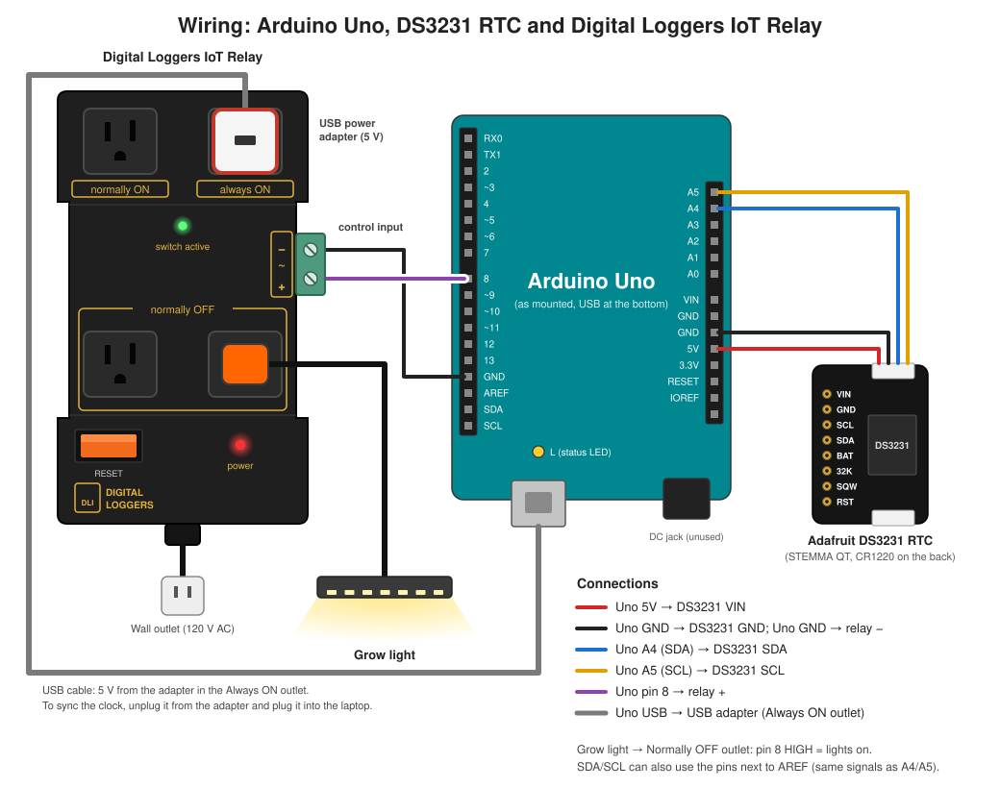

# 2. Wiring: Arduino, DS3231 and IoT Relay

The DS3231 stays wired to the Arduino permanently. Nothing needs to be unplugged to set the clock.

[← Back to guides](README.md) · [← 1. Arduino setup](01_arduino_setup.md)

---

## DS3231 → Arduino

| DS3231 pin | Arduino Uno pin | Color in diagram |
|-----------|-----------------|---------|
| **VCC** | **5V** (or **3.3V**, see the battery note below) | red |
| **GND** | **GND** | black |
| **SDA** | **A4** (or the pin labelled **SDA** next to AREF) | blue |
| **SCL** | **A5** (or the pin labelled **SCL** next to AREF) | yellow |

Leave **SQW** and **32K** unconnected. Pin order differs between DS3231 modules, so match each wire to the **label printed on your module**.

> **Battery note:** blue **ZS-042** modules have a charging circuit that slowly damages a normal CR2032 when powered from 5 V. Either power the module from the Uno's **3.3V** pin, or remove the charging resistor. See [guide 5](05_battery_and_maintenance.md#zs-042-charging-circuit-warning).

> **Not using an Uno?** The I²C pins move: Nano / Pro Mini → A4 (SDA), A5 (SCL). Mega → 20 (SDA), 21 (SCL). Leonardo / Micro → 2 (SDA), 3 (SCL). Uno R4 → A4/A5 or the SDA/SCL header pins. Most boards also print `SDA`/`SCL` on the header.

## Arduino → Digital Loggers IoT Relay

| Arduino pin | IoT Relay terminal | Color in diagram |
|-------------|--------------------|---------|
| **Digital pin 8** | **+** (control input) | purple |
| **GND** | **−** (control input) | black |

- The green control-input terminal block is on the side of the IoT Relay. Strip about 6 mm of wire, insert, and tighten.
- **Polarity matters**: pin 8 goes to **+**, GND goes to **−**.
- The control input is a low-voltage DC input (roughly 3–48 V DC; check the label on your unit), so an Arduino pin drives it directly with no extra transistor or resistor.

## Which outlet do the lights go in?

| Outlet | Pin 8 LOW | Pin 8 HIGH |
|--------|-----------|-----------|
| Always ON | on | on |
| Normally ON | on | **off** |
| **Normally OFF** (×2) | off | **on** |

**Plug the lights into a "Normally OFF" outlet.** Then `HIGH` in the schedule = lights on.

## Powering the Arduino

The Uno has **one** USB port, and you'll plug a laptop into it about once a year to sync the clock. Two options:

| Option | Pros | Cons |
|--------|------|------|
| **9 V DC adapter in the barrel jack** (recommended) | USB port stays free: plug the laptop in without unplugging power | Needs a 7–12 V center-positive adapter |
| **5 V USB wall adapter** in the USB port | Uses any phone charger | You unplug it to connect the laptop, so the Arduino restarts (a ~2 s blip) |

Either way, the Arduino may restart for about 1–2 seconds when the laptop connects ([why](03_sync_clock_from_laptop.md#will-syncing-blink-the-lights)). Plugging the adapter into the IoT Relay's **Always ON** outlet lets everything run from one wall socket.

## Final check on site

- The Arduino's **L** LED gives a **short blink every 2 seconds** → running normally.
- **Fast blinking** → clock not set or RTC problem. Run the [laptop sync](03_sync_clock_from_laptop.md).
- The relay's own indicator light should match the schedule.

---

**Next:** [3. Sync the clock from a laptop →](03_sync_clock_from_laptop.md)
