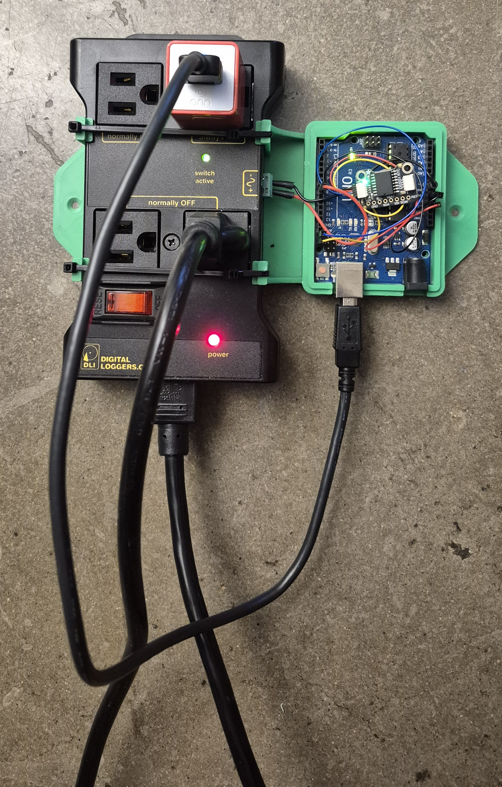

# 2. Wiring

The DS3231 stays wired to the Arduino permanently, so you don't need to disconnect anything to set the clock.

[← Guides](README.md) · [← 1. Arduino setup](01_arduino_setup.md)

---

  
   <em>Reference build, with the DS3231 lifted out to show the wiring.</em>

## DS3231 to Arduino

The reference build uses the **Adafruit DS3231 Precision RTC (STEMMA QT)** board, connected with a STEMMA QT / Qwiic to male-header cable. The cable's wire colors follow the STEMMA QT standard.

| DS3231 pin | Arduino Uno pin | STEMMA QT wire color |
|------------|-----------------|----------------------|
| **VIN** | **5V** | red |
| **GND** | **GND** | black |
| **SDA** | **A4**, or the **SDA** pin next to AREF | blue |
| **SCL** | **A5**, or the **SCL** pin next to AREF | yellow |

The SDA/SCL pins next to AREF carry the same signals as A4/A5, so you can use either pair. Leave **BAT**, **32K**, **SQW** and **RST** unconnected. Pin order differs between DS3231 modules, so match each wire to the label printed on the board.

  
  &nbsp;
  
   <em>Adafruit DS3231 STEMMA QT: pin labels on the front, CR1220 holder on the back.</em>

> **Other DS3231 modules:** Blue **ZS-042** boards have a battery-charging circuit that can damage a non-rechargeable coin cell at 5 V. Read [Using a different DS3231 module](05_battery_and_maintenance.md#using-a-different-ds3231-module) before you use one.

> **Other Arduino boards:** The I²C pins differ between boards.
>
> | Board | SDA | SCL |
> |-------|-----|-----|
> | Nano, Pro Mini | A4 | A5 |
> | Mega | 20 | 21 |
> | Leonardo, Micro | 2 | 3 |
> | Uno R4 | A4, or the SDA header pin | A5, or the SCL header pin |
>
> Most boards also print `SDA`/`SCL` next to the header.

## Arduino to the IoT Relay control input

| Arduino pin | IoT Relay terminal | Wire color in diagram |
|-------------|--------------------|-----------------------|
| **Digital pin 8** | **+** | purple |
| **GND** | **−** | black |

- The green two-pin control terminal is on the side of the relay, marked **+ ∿ −**. Strip about 6 mm of each wire, insert it, and tighten the screw.
- **Polarity matters.** Pin 8 goes to **+** and GND goes to **−**.
- The control input accepts low-voltage DC (about 3–48 V DC; check the label on your unit), so an Arduino pin can drive it directly. You don't need a transistor or resistor.

  
   <em>Control terminal: <b>+</b> (left in this view) goes to pin 8, <b>−</b> goes to GND.</em>

## Outlet assignment and power

  

The IoT Relay has four outlets:

| Outlet | Pin 8 `LOW` | Pin 8 `HIGH` | Used for |
|--------|-------------|--------------|----------|
| **Always ON** | on | on | **USB power adapter for the Arduino** |
| Normally ON | on | off | (not used) |
| **Normally OFF** (×2) | off | on | **Grow light** |

- **Grow light → Normally OFF outlet.** With this setup, `HIGH` in the schedule means lights on.
- **Arduino power → Always ON outlet.** A 5 V USB adapter in the Always ON outlet powers the Arduino through its USB port. The whole system runs from one wall socket, and the Arduino keeps power whatever state the relay is in.

### Syncing with a USB-powered Arduino

The Uno has one USB port, and the laptop uses that port during a [clock sync](03_sync_clock_from_laptop.md). To sync, unplug the USB cable from the power adapter and plug it into the laptop. Plug it back into the adapter when the sync finishes.

While the cable is unplugged, the Arduino has no power, so the relay switches off and the grow light goes off. When power returns, the Arduino restarts and restores the scheduled state within about two seconds. To avoid any interruption, sync during the lights-off period.

> **Optional: keep the USB port free.** You can power the Uno from a 7–12 V center-positive adapter in its DC barrel jack instead, also plugged into the Always ON outlet. A laptop can then connect without removing power. The Uno may still restart for 1–2 seconds when the serial port opens ([details](03_sync_clock_from_laptop.md#does-syncing-interrupt-the-lights)).

## Enclosure

The reference build uses a 3D-printed mount that holds the relay with zip ties and encloses the Arduino. For the source models and assembly steps, see [`enclosure/`](../enclosure/README.md).

## Final check

- The Arduino's **L** LED gives a **short blink every 2 seconds**: the timer is running normally.
- The **L** LED is **fast-blinking**: the clock isn't set or the RTC has a problem. Run the [clock sync](03_sync_clock_from_laptop.md).
- The relay's green **switch active** LED matches the schedule.

---

**Next:** [3. Clock sync →](03_sync_clock_from_laptop.md)
