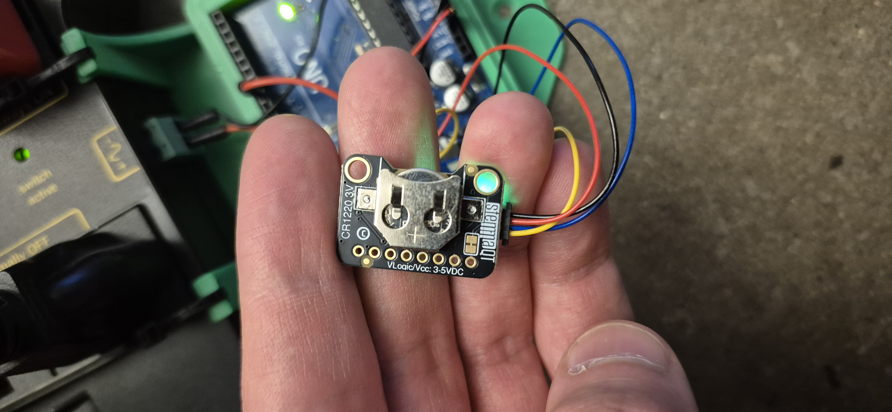

# 5. Battery and Maintenance

[← Guides](README.md) · [← 4. Daylight saving time](04_daylight_saving_time.md)

---

## What the coin cell does

The DS3231 normally runs from the Arduino's power supply. The coin cell (a **CR1220** on the Adafruit STEMMA QT board) **only keeps the clock running when that power is lost**, for example during a power cut or while the system is unplugged.

In backup mode the DS3231 draws only a few microamps, so a cell rarely runs flat from use. Cells usually fail from age or a poor contact.

If the cell is dead **and** power is lost, the clock stops. When power returns, the Arduino detects this through the DS3231's *lost-power flag*. It holds the relay in `FAILSAFE_STATE` and fast-blinks the **L** LED until the cell is replaced and the clock is re-synced. The timer never runs the schedule from an invalid clock.

<p align="center">
  
</p>

## When to replace the coin cell

`sync_rtc.py` tracks the cell for you. Replace it when **any** of these occurs:

| Indicator | Where it appears |
|-----------|------------------|
| `REPLACE THE COIN CELL NOW` | `sync_rtc.py` report: the RTC lost all power since the last sync |
| `Coin cell is 3.0 years old: replace it` | `sync_rtc.py` report, based on the recorded install date |
| The **L** LED fast-blinks after a power cut | On the Arduino |
| A multimeter reads **below 2.8 V** across the cell | A fresh cell reads about 3.0–3.3 V |

### Replacing the cell

1. **Keep the Arduino powered.** Remove the old cell and insert the new one **with `+` facing up**. The clock keeps running on main power, so it doesn't lose time.
2. Connect the laptop and run:

   ```bash
   py laptop_sync/sync_rtc.py --battery-replaced
   ```

   This syncs the clock and records today as the install date for future reminders.

If you replace the cell with the power off, the clock stops. The Arduino fast-blinks until you run the same command.

## Using a different DS3231 module

The timer works with any DS3231 module. The **Adafruit DS3231** boards, including the STEMMA QT version used in the reference build, have no charging circuit and need no changes.

Many low-cost blue **ZS-042** modules include a **battery-charging circuit** designed for rechargeable LIR2032 cells. You can identify them by a second 8-pin chip (an AT24C32 EEPROM) and a CR2032 holder on the back. The circuit is a small diode and a 200 Ω resistor, often marked **`201`**. When the module is powered from **5 V**, the circuit pushes current into a non-rechargeable CR2032. Over time, this can make the cell swell, leak or fail.

If you use a ZS-042, apply **one** of these fixes:

1. **Power the module from 3.3 V** instead of 5 V. Connect its VCC to the Uno's `3.3V` pin. At 3.3 V, almost no charging current flows.
2. **Remove the charging path.** Desolder or cut one leg of the resistor marked `201`, or of the diode next to it.
3. **Use a rechargeable LIR2032** cell instead of a CR2032.

## Yearly maintenance checklist

One check a year keeps the clock accurate and catches battery problems early. It takes about 10 minutes. If you can, do it during the lights-off period.

- [ ] Close the Arduino IDE Serial Monitor, then move the Arduino's USB cable from the power adapter to the laptop.
- [ ] Run `sync_rtc.py` and review the report:
  - If the report says `REPLACE THE COIN CELL NOW` or `…years old: replace it`, replace the cell and run the script again with `--battery-replaced`.
  - If drift is flagged `[!!]` (more than ±5 ppm), monitor it at the next check. Replace the module if the warning persists.
- [ ] Confirm that the *Local time* line matches the current local time.
- [ ] Plug the USB cable back into the power adapter, and confirm that the **L** LED gives a short blink every 2 seconds.

## Accuracy between syncs

The DS3231 has a temperature-compensated crystal oscillator, rated at **±2 ppm** from 0 to 40 °C. That works out to **about one minute per year at most**. Each sync measures the actual drift in ppm, so a failing module shows up early.

---

**Next:** [6. Troubleshooting →](06_troubleshooting.md)
