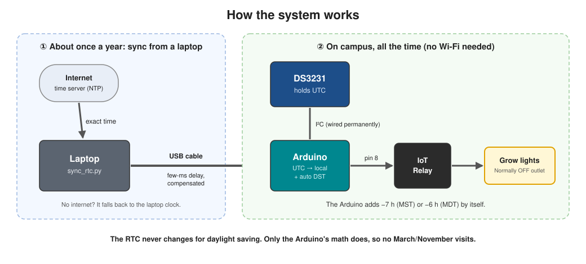

# Build and Operation Guide

These guides cover how to build, configure, sync and maintain the DS3231 Relay Timer.

## How it works

The DS3231 real-time clock is wired permanently to the Arduino and keeps time in **UTC**. The Arduino converts UTC to local time, applies daylight saving time, and switches the IoT Relay to match the schedule. About once a year, you connect a laptop over USB and run `sync_rtc.py`. The script sets the RTC from internet time, cancels out the USB delay, and reports the clock's drift and battery health.

## Guides

Work through the guides in order for a first build.

| # | Guide | Covers |
|---|-------|--------|
| 1 | [Arduino setup](01_arduino_setup.md) | Arduino IDE and RTClib, the schedule, uploading, serial commands |
| 2 | [Wiring](02_wiring.md) | DS3231 and IoT Relay connections, outlet assignment, powering the Arduino |
| 3 | [Clock sync](03_sync_clock_from_laptop.md) | Python setup, running `sync_rtc.py`, reading the report, how the USB delay is cancelled |
| 4 | [Daylight saving time](04_daylight_saving_time.md) | Why the RTC stores UTC, the DST rule, changing time zones |
| 5 | [Battery and maintenance](05_battery_and_maintenance.md) | When to replace the coin cell, other DS3231 modules, the yearly checklist |
| 6 | [Troubleshooting](06_troubleshooting.md) | LED codes, script errors, lights switching at the wrong time |

## Diagrams and photos

| Diagram | File |
|---------|------|
| System overview | [images/system_overview.svg](images/system_overview.svg) |
| Wiring: Arduino Uno, DS3231 and IoT Relay | [images/arduino_ds3231_relay.svg](images/arduino_ds3231_relay.svg) |

For photos of the reference build, see [photos/](photos/README.md).

## Bill of materials

| Part | Notes |
|------|-------|
| Arduino Uno R3 (or compatible) | Nano, Mega and Uno R4 also work. See the [I²C pin notes](02_wiring.md#ds3231-to-arduino). |
| Adafruit DS3231 Precision RTC (STEMMA QT) | Runs on 3–5 V and has no charging circuit. [Other DS3231 modules](05_battery_and_maintenance.md#using-a-different-ds3231-module) also work. |
| CR1220 coin cell | Keeps the RTC running during power cuts |
| STEMMA QT / Qwiic to male-header cable | Connects the RTC to the Arduino headers. Four jumper wires also work. |
| Digital Loggers IoT Relay | Switches the grow light |
| 2 jumper wires | Connect Arduino pin 8 and GND to the relay's control terminal |
| 5 V USB power adapter and USB cable | Powers the Arduino from the relay's **Always ON** outlet |
| Laptop with Python 3 | Used for clock syncs. Any OS works. |
| 3D-printed mount (optional) | See [`enclosure/`](../enclosure/README.md) |

## Pin reference

| Arduino Uno pin | Connects to | Wire color in diagram |
|-----------------|-------------|-----------------------|
| 5V | DS3231 VIN | red |
| GND | DS3231 GND | black |
| A4 (or the SDA pin next to AREF) | DS3231 SDA | blue |
| A5 (or the SCL pin next to AREF) | DS3231 SCL | yellow |
| Digital pin 8 | IoT Relay control **+** | purple |
| GND | IoT Relay control **−** | black |
| USB port | USB power adapter, or a laptop during a sync | gray |
