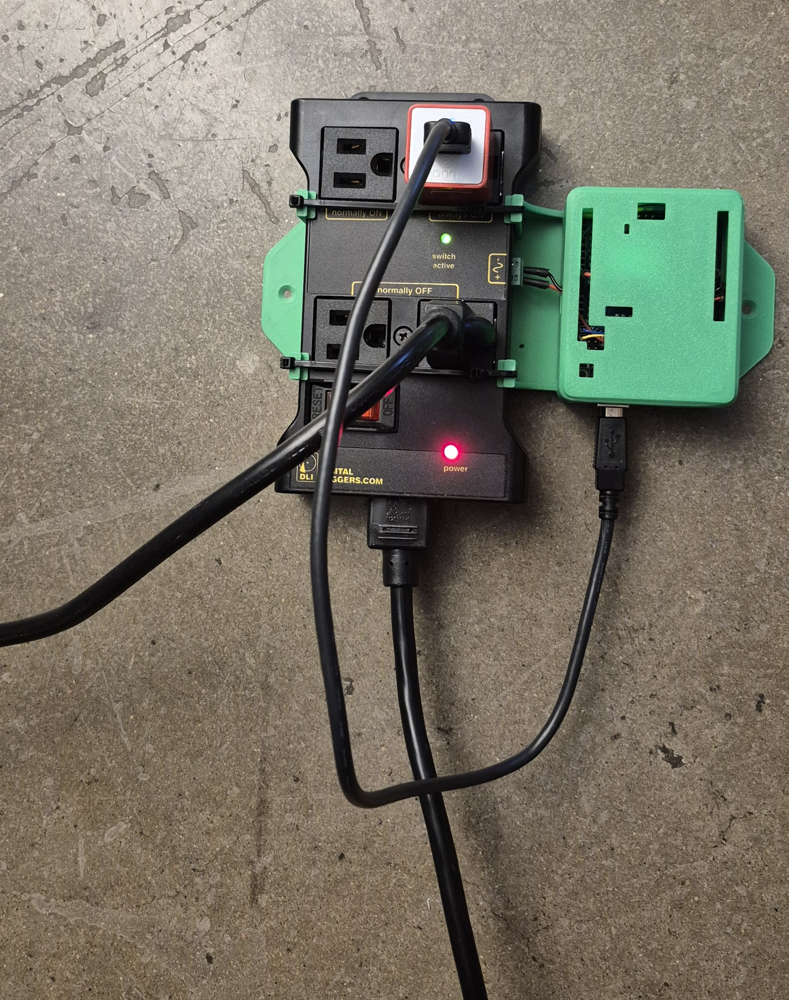
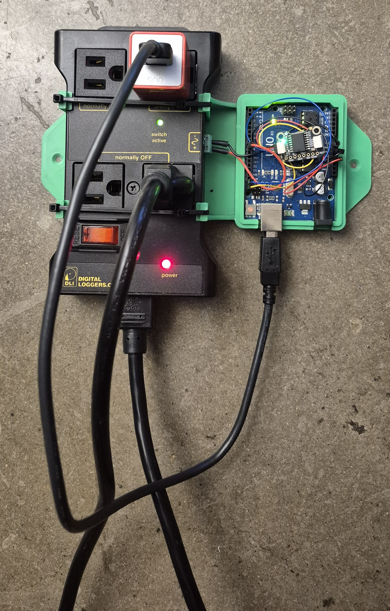
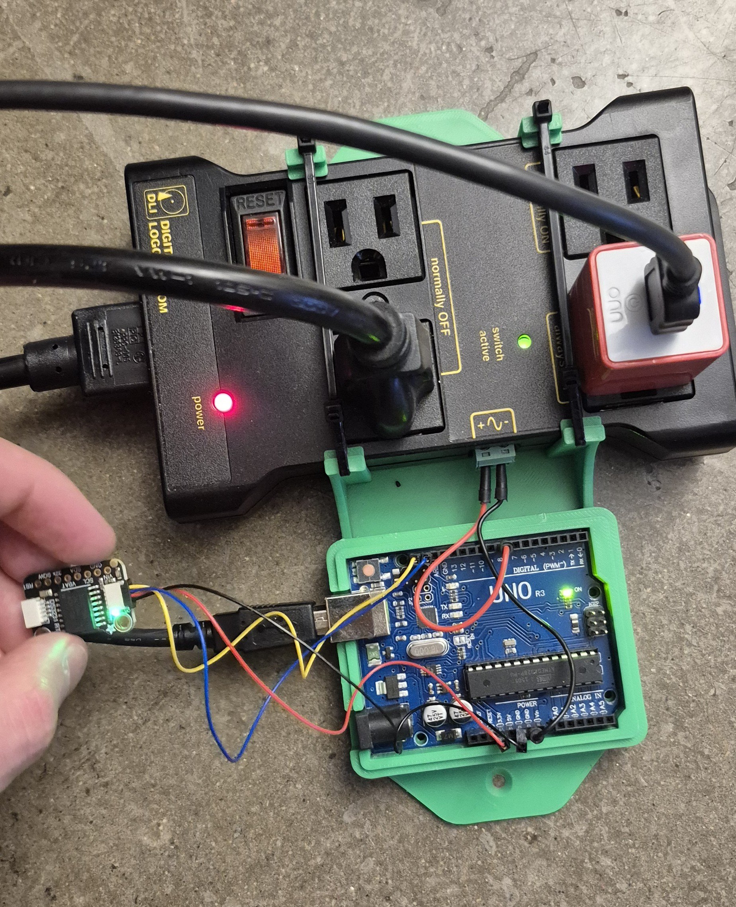
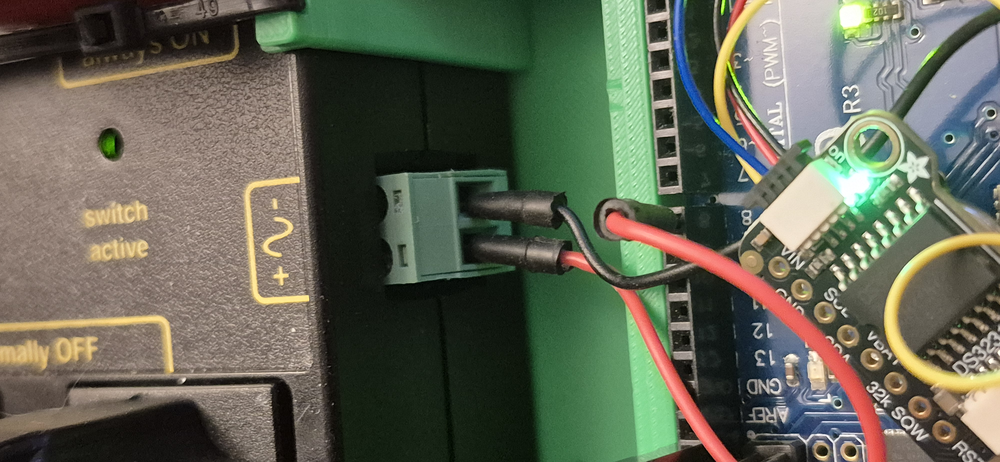
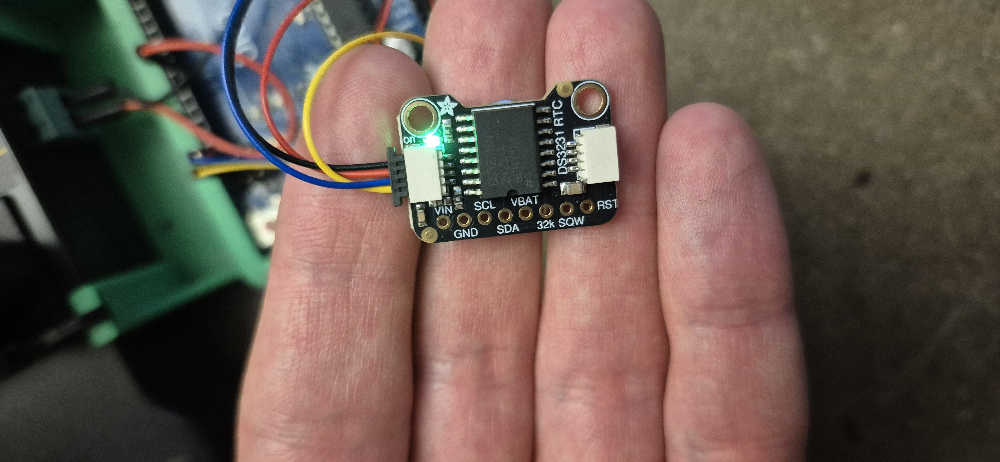
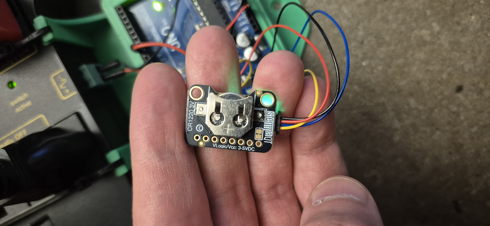

# Reference Build Photos

These photos show the assembled reference build. For the wiring diagrams, see [`../images/`](../images).

| Photo | Shows | Used in |
|-------|-------|---------|
| [`Full_lid_on.jpg`](Full_lid_on.jpg) | The complete build in the 3D-printed mount, with the Arduino cover fitted | [README](../../README.md), [enclosure](../../enclosure/README.md) |
| [`Full_lid_off.jpg`](Full_lid_off.jpg) | The same build with the cover removed: USB adapter in **Always ON**, grow light in **Normally OFF**, Arduino wired to the control terminal | [README](../../README.md), [02 Wiring](../02_wiring.md#outlet-assignment-and-power), [enclosure](../../enclosure/README.md) |
| [`Wiring.jpg`](Wiring.jpg) | The DS3231 lifted out to show the four RTC wires and the two relay control wires | [02 Wiring](../02_wiring.md) |
| [`Relay_terminal_closeup.jpg`](Relay_terminal_closeup.jpg) | The IoT Relay's **+ ∿ −** control terminal with pin 8 (+) and GND (−) connected | [02 Wiring](../02_wiring.md#arduino-to-the-iot-relay-control-input) |
| [`ds3231_front.jpg`](ds3231_front.jpg) | The Adafruit DS3231 STEMMA QT board: pin labels and STEMMA QT connectors | [02 Wiring](../02_wiring.md#ds3231-to-arduino) |
| [`ds3231_back.jpg`](ds3231_back.jpg) | The back of the DS3231 board: the CR1220 coin-cell holder | [02 Wiring](../02_wiring.md#ds3231-to-arduino), [05 Battery](../05_battery_and_maintenance.md) |

  
  &nbsp;
  

  
  &nbsp;
  

  
  &nbsp;
  

